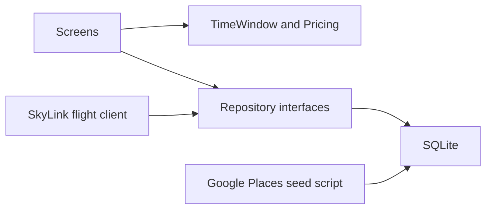

# Airport delivery demoware

Passenger Expo app for Hartsfield-Jackson (ATL). It matches the product spec and the PNGs in `artboards/`. The phone reads and writes SQLite. Screens talk only to repository interfaces, so a webservice client can replace the database later without rewriting the UI.

Start a new chat by reading this file, then the current phase under `docs/phases/`. Finish one phase before starting the next. Update that phase file's status when the work is done.

Repository: https://github.com/MMcFarlane/f2-airport-delivery-app-mvp

Working branch: `main`.

The iOS `bundleIdentifier` and Android `package` in `app.json` are `com.f2delivers.wingsnack`. Don't change them. The first TestFlight build shipped with this ID, and a new ID installs as a different app. For the release steps, see `docs/testflight.md`.

## Product

A passenger opens the app, sets who they are and when they fly, and only sees food that can be cooked and delivered before they board. After payment they get a 4-character code to give the courier. The order is stored locally as sent to the restaurant.

Spec behavior:

1. Home shows three carousels: Restaurants, Featured items, Specials and bundles.
2. A first-launch sheet collects name, gate, and departure time. Those values drive what is orderable.
3. Each carousel can be swiped. See all opens the full list.
4. Choosing a restaurant opens its menu.
5. Every item shows how long it takes to prepare and deliver.
6. Add to cart works only when the item fits the delivery window.
7. Pay produces a confirmation code and records the order for the restaurant.
8. Featured items and specials are filtered by the same window.
9. Item detail shows photo, description, discount code, price, and add to cart.
10. Browse is a search hub: a flight chip, search, time and price chips, counts for restaurants, featured items, and specials, and six category cards.

Home matches `artboards/home/Departure board@1x.png`, except its fourth tab. That PNG draws Cart. The app uses Account, matching the other tabbed artboards.

## What this build includes

- Local fixture catalog that matches the artboards (Runway Burger, Gate Café, Jetstream Juice, FLY10, Visa ending 4242, three past orders).
- Optional Google Places seed for real ATL restaurant identity.
- Live SkyLink ATL departures board on launch, and a gate lookup that fills the gate when it has been published.
- Simulated pay, a local confirmation code, and a demo control that advances order status.
- A demo Courier view: a Google Map from the restaurant to the passenger's phone location, captured at checkout and watched live, with the gate as fallback.

## What this build leaves out

Boarding-pass scan, real card charges, accounts, push or SMS, a restaurant inbox, live courier GPS, and sending the passenger's location to a separate courier device (that needs a server).

## Airport

One config module is the source of truth:

- IATA `ATL`
- ICAO `KATL`
- Timezone `America/New_York`
- Terminal-area center near `33.6407, -84.4277`

Places seeding and the SkyLink departures board both read that module. Changing airports means editing the config and re-running the seed.

## Architecture

- `src/domain/` holds the time-window and pricing rules. The same functions run on fixture rows, Places-backed rows, or a future API payload.
- `src/data/repositories.ts` defines `CatalogRepository`, `TripRepository`, `CartRepository`, `OrderRepository`, `ProfileRepository`, and `FlightRepository`. Methods return domain types, never SQL rows or HTTP shapes.
- `src/data/sqlite/` implements the stored repositories with `expo-sqlite`.
- `src/data/skylink/` holds the SkyLink v3.1 client and mapping. `SqliteFlightRepository` stores the live board and gate answers in SQLite and serves `FlightRepository` from there.
- `src/data/index.ts` is the only composition root: `createDataSource()`. Screens and hooks import that. They do not import `expo-sqlite`.
- Missing keys do not crash the app. No Places data means the fixture catalog. No SkyLink key means manual gate and departure only.
- `CATALOG_SOURCE=fixtures` or `places` selects the catalog. Fixtures are the default.
- Keys live in a gitignored env file: `GOOGLE_PLACES_API_KEY`, `SKYLINK_API_KEY`, `GOOGLE_MAPS_API_KEY`. The Places key stays in the seed script, off the device. The Maps key is built into the native app by the `react-native-maps` config plugin. The current Maps key is temporarily shared with another app and must be replaced with a dedicated, restricted key by Friday, October 23, 2026 (see [phases/08b-courier-map.md](phases/08b-courier-map.md)). No key means Apple Maps on iOS and a summary card on Android and web. The SkyLink key is read by the app for this demo. A later proxy should hold it before any public build. Never commit either key.

## Domain rules

Taken from the mocks. A 15:40 departure is the reference case.

- Boarding starts 30 minutes before departure (15:10).
- Deliver-by is 10 minutes before boarding (15:00).
- An item fits when `now + prepMinutes <= deliverBy`.
- A cart cooks in parallel. Arrival is `now + the longest prep time` in the cart.
- Spare minutes are `boarding - arrival`.
- Items and restaurants that miss the window stay visible and are marked too late. Their add button is disabled.
- FLY10 is 10% off the item it was applied to.
- Gate delivery fee is $2.49.
- Tax is 8% of discounted food only. Fee and tip are not taxed.
- Tip presets are $2, $3, $5, and Other. The default is $3.
- A looked-up flight stores flight number, airline, status, departure instant, and gate on the local trip. A gate from SkyLink is marked `skylink`; a typed gate is `manual` and is never replaced. An unpublished SkyLink gate stays editable. The time window uses the stored departure instant, so it still works if the network drops.

Reference cart math from the mock: subtotal $21.00, FLY10 on the $14.50 burger is -$1.45, gate fee $2.49, tax $1.56, tip $3.00, total $26.60.

## Screens

Tabs: Home, Browse, Orders, Account.

Cart is not a tab. The header bag on Home and Featured items opens it, as does the menu View cart bar. Cart, the menu, item detail, confirmation, and the Courier view have no tab bar. The trip sheet covers the tab bar.

| Screen | Artboard |
| --- | --- |
| Home | `artboards/home/Departure board@1x.png` |
| Trip sheet | `artboards/departure_and_food_order/Trip setup pop-up@1x.png` |
| Restaurant menu | `artboards/departure_and_food_order/Restaurant menu@1x.png` |
| Item detail | `artboards/departure_and_food_order/Item detail@1x.png` |
| Cart and pay | `artboards/departure_and_food_order/Cart & checkout@1x.png` |
| Confirmation | `artboards/departure_and_food_order/Order confirmed · code@1x.png` |
| Browse hub | `artboards/browse/Browse · search everything@1x.png` |
| All restaurants | `artboards/restaurant_details/All restaurants · search & filter@1x.png` |
| Featured items | `artboards/restaurant_details/All featured items · search & filter@1x.png` |
| Specials and bundles | `artboards/restaurant_details/All specials & bundles@1x.png` |
| Orders | `artboards/restaurant_details/Orders · active & past@1x.png` |
| Account | `artboards/restaurant_details/Profile@1x.png` |

Home stays active on Home. Browse stays active on the hub and the three list screens. Orders stays active on Orders. Account stays active on Account.

## Phases

| Phase | File | Status |
| --- | --- | --- |
| 0. Repo and shell | [phases/00-repo-and-shell.md](phases/00-repo-and-shell.md) | Done |
| 1. Theme | [phases/01-theme.md](phases/01-theme.md) | Done |
| 2. Data boundary | [phases/02-data-boundary.md](phases/02-data-boundary.md) | Done |
| 2b. Places seed | [phases/02b-places-seed.md](phases/02b-places-seed.md) | Done |
| 3. Trip and time window | [phases/03-trip-and-time-window.md](phases/03-trip-and-time-window.md) | Done |
| 3b. SkyLink | [phases/03b-skylink.md](phases/03b-skylink.md) | Done |
| 4. Home | [phases/04-home.md](phases/04-home.md) | Done |
| 5. Browse lists | [phases/05-browse.md](phases/05-browse.md) | Done |
| 6. Menu and item | [phases/06-menu-and-item.md](phases/06-menu-and-item.md) | Done |
| 7. Cart, pay, code | [phases/07-cart-pay-code.md](phases/07-cart-pay-code.md) | Done |
| 8. Orders and account | [phases/08-orders-and-account.md](phases/08-orders-and-account.md) | Done |
| 8a. Browse hub | [phases/08a-browse-hub.md](phases/08a-browse-hub.md) | Done |
| 8b. Courier map | [phases/08b-courier-map.md](phases/08b-courier-map.md) | Done in code; device check pending |
| 9. Mock pass | [phases/09-mock-pass.md](phases/09-mock-pass.md) | Not started |

## External APIs

Google Places is a seed script, not a call from the phone. It writes restaurant name, place id, address, lat/lng, rating, photo, and type. It does not supply menus, prices, or prep times.

SkyLink is live, with a 5,000 calls a month budget:

- `GET https://data.skylinkapi.com/v3.1/schedules/departures?iata=ATL` runs on launch, at most every 15 minutes. It replaces the stored 12-hour board. Launch never waits on it; only the trip sheet's flight list does.
- `GET https://data.skylinkapi.com/v3.1/flight_status/{flight_number}` runs when a board flight is picked, and on launch for a saved trip whose gate came from SkyLink. Answers are cached for 5 minutes.

Both send header `x-api-key`. Every launch deletes departures and gate answers from past airport days, so the tables hold one day at most. With no stored board and no network, the bundled `src/data/skylink/departures.json` snapshot fills the list.

Live `flight_status` names the airport as `ATL • Atlanta` and sends `--` for an unpublished gate or terminal. Treat `--` and `""` as unknown. The board uses `scheduled_time`; departure time is not moved from `actual_time`. Dates look like `11 Feb` and have no year. Parse them in `America/New_York`, using today's year, and the next calendar year only when that month-day is already past.
